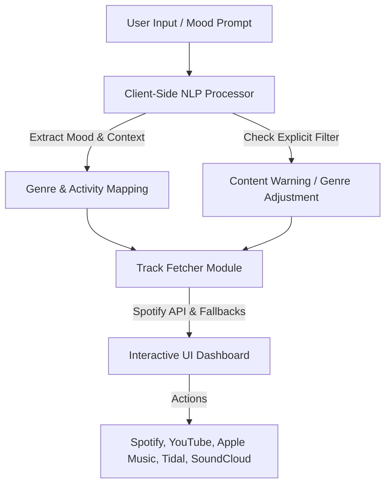

# GrooveEstrella (Groove 2.0) 🎵

### **A Premium AI-Powered Music Discovery & Recommendation Platform**

GrooveEstrella is a state-of-the-art music web application designed to deliver highly personalized music recommendations. Rebuilt from the ground up on Next.js, GrooveEstrella bridges multiple music platforms—including Spotify, YouTube, Apple Music, Tidal, and SoundCloud—into a unified, modern interface. Leveraging advanced client-side Natural Language Processing (NLP), GrooveEstrella understands your mood, activities, and content preferences to craft the perfect soundtrack for your day.

---

## 🌟 **Key Features**

- **🤖 Intelligent Client-Side NLP Chat**: A native Natural Language Processing engine that analyzes your messages to detect emotions (sadness, joy, romance, energy) and activity contexts (coding, studying, working out) to serve context-aware recommendations.
- **🔌 Multi-Platform Integration**: Direct action support across **Spotify**, **YouTube**, **Apple Music**, **Tidal**, and **SoundCloud** on tracks, albums, artists, and playlists.
- **📻 Dynamic Music Discovery Dashboard**: Interactive feed containing daily recommendations, category filtering via responsive chips, paginated lists, and live API status checks.
- **🔗 Unified Sharing Suite**: A centralized, custom share modal supporting direct links, QR code preview generation, social share options, and native device sharing.
- **🛡️ Smart Content Filter**: Active profanity, drugs, violence, and sexual content detection with customizable severity levels and content warnings.
- **🛹 Premium Onboarding**: Step-by-step interactive onboarding for first-time users to configure credentials and tailor their initial experience.

---

## 🛠️ **Tech Stack**

- **Frontend Framework**: Next.js 14+ (App Router) & React
- **Styling**: Tailwind CSS & Modern Glassmorphic CSS
- **APIs & Data Source**: Spotify Web API & YouTube API
- **NLP Engine**: Custom client-side MusicNLPProcessor
- **Database Layer**: Seamless serverless endpoints and helper clients

---

## 📊 **How It Works**



1. **Vibe Input**: Enter how you feel or what you are doing (e.g., "coding in my room" or "feeling pumped at the gym").
2. **Context Parsing**: The NLP engine extracts emotions and matches them against target genres and activity mappings.
3. **Smart Filtering**: Explicit detection layers check the prompt for sensitive terms and apply safe-search boundaries or alert flags.
4. **Music Aggregation**: The dashboard retrieves matching tracks from platform endpoints and serves them with full audio options.

---

## 🚀 **Getting Started & Running Locally**

Follow these instructions to run GrooveEstrella on your local machine:

### 1. Clone the project
```bash
git clone https://github.com/farhanalireza/grooveestrella.git
cd grooveestrella
```

### 2. Configure Environment Variables
Create a `.env` or `.env.local` file inside the `frontend` folder with your platform credentials (e.g., Spotify API Client ID & Client Secret).

### 3. Install Dependencies
Navigate to the frontend workspace and install the required npm packages:
```bash
cd frontend
npm install
```

### 4. Run the Development Server
```bash
npm run dev
```
Open [http://localhost:3000](http://localhost:3000) with your browser to experience GrooveEstrella 2.0!

---

## 👥 **Authors**

- [Farhan Ali Reza](https://www.github.com/oopsvincent)
- [Soumodip Mondal](https://www.github.com/soumodip-esc)

---

## 🔗 **Links**
[](https://farhanalireza.netlify.app)
[](https://www.linkedin.com/oopsvincent)
[](https://twitter.com/oopsvincent)
